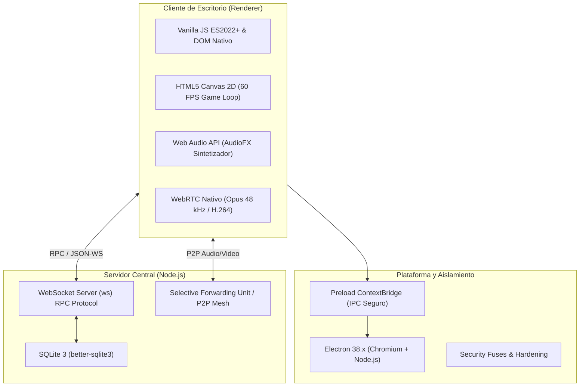
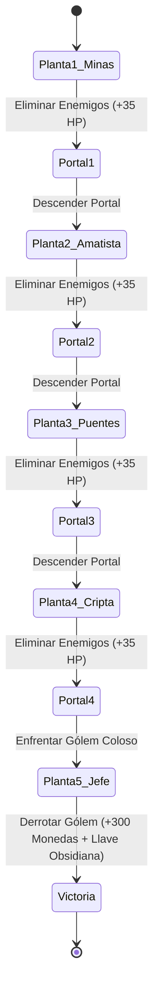
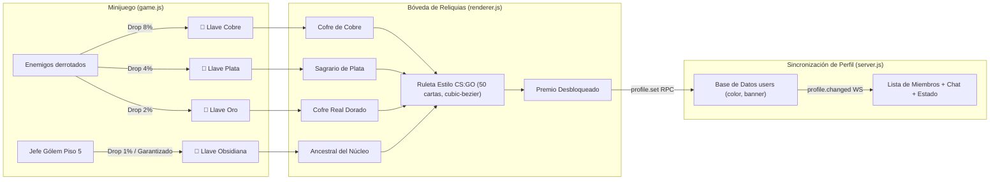
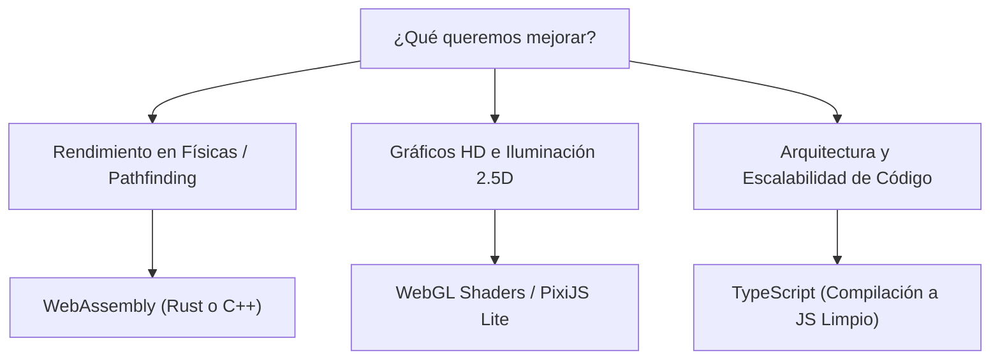

# EpicKast • Arquitectura Técnica, Minijuego y Sistema de Recompensas

Este documento compila el desglose técnico integral del stack tecnológico de **EpicKast**, la arquitectura y fórmulas matemáticas del minijuego (**Dungeons of the Core**), el funcionamiento del sistema de cofres y recompensas de perfil (Bóveda de Reliquias), y las alternativas viables de tecnologías y lenguajes para escalar el proyecto sin mermar el rendimiento ni violar las políticas de la **Microsoft Store**.

---

## 1. Stack Tecnológico y Lenguajes Actuales de EpicKast

La arquitectura de EpicKast fue concebida para ofrecer **latencia ultra-baja y consumo mínimo de recursos** (60–140 MB de memoria RAM en reposo frente a los 600–900 MB de Discord o Slack). No utiliza frameworks pesados (como React, Angular o Vue), eliminando el Virtual DOM y el sobrecoste de abstracción.

### Detalle de Lenguajes y Componentes:

| Capa | Tecnologías / Lenguajes | Rol en la Aplicación |
| :--- | :--- | :--- |
| **Entorno de Ejecución** | **Electron 38.8.6** (Chromium + Node.js) | Contenedor de escritorio multiplataforma con integración directa a APIs del sistema operativo de Windows. |
| **Lógica de Interfaz** | **JavaScript Vanilla (ES2022+)** | Manipulación directa del DOM con funciones de renderizado funcional (`h(tag, props, ...children)`). Cero dependencias de frameworks. |
| **Estilos y Maquetación** | **CSS3 Puro** (Variables CSS, Flexbox, Grid) | Estilizado modular, soporte responsivo para ventanas partidas al 50% y monitores de distintas resoluciones, animaciones aceleradas por GPU (`will-change: transform`). |
| **Motor del Minijuego** | **HTML5 Canvas 2D Context API** | Bucle de simulación física a 60 FPS con paso de tiempo variable (`dt`), detección de colisiones AABB + círculos, proyección de partículas y renderizado procedimental de entidades. |
| **Audio del Minijuego** | **Web Audio API** (`AudioContext`, `OscillatorNode`) | Síntesis procedimental de efectos de sonido en tiempo real (ataques, impactos, recogida de monedas, ticks de ruleta, sonido de victoria). **Cero consumo de almacenamiento** al no requerir archivos `.wav` o `.mp3` pesados. |
| **Servidor de Comunicación** | **Node.js + WebSockets (`ws`)** | Servidor RPC bidireccional de baja latencia con sincronización de estado, presencia, roles, mensajes y salas de voz. |
| **Base de Datos** | **SQLite (vía `better-sqlite3`)** | Almacenamiento persistente relacional embebido de alta velocidad (lecturas y escrituras síncronas en C++, sin sobrecoste de red). |
| **Empaquetado y Distribución** | **electron-builder** (NSIS + AppX) | Generador de instalador nativo de Windows (NSIS ejecutable) y paquete sellado UWP/AppX para la tienda Microsoft Store. |

---

## 2. Minijuego: "Dungeons of the Core" (Mecánicas y Código)

El minijuego es un RPG de acción estilo *Dungeon Crawler* en vista cenital (top-down) inspirado en mecánicas clásicas de exploración de mazmorras.

### 2.1. Arquitectura del Bucle de Juego (`app/game.js`)
* **Bucle principal:** Ejecutado mediante `requestAnimationFrame(this.loop.bind(this))` con cálculo de `delta time` (`dt = (now - lastTime) / 1000`).
* **Física y Deslizamiento en Muros:** El movimiento utiliza vectores normalizados (`dx * 0.7071` al moverse en diagonal) y colisión por separación de ejes en una matriz de baldosas (`FLOOR_MAPS`, matriz de $24 \times 15$ bloques de $32 \times 32\text{ px}$). Si el personaje colisiona horizontalmente, el vector vertical no se anula, produciendo un deslizamiento suave sobre las paredes.
* **Progresión de 5 Pisos:**
  1. **Nivel 1 (Entrada de las Minas de Magma):** Zombis Mineros armados con picos y linternas frontales.
  2. **Nivel 2 (Galerías de Amatista y Sombras):** Esqueletos Centinela con arcos rúnicos que disparan a distancia.
  3. **Nivel 3 (Puentes de Lava y Basalto):** Pasarelas estrechas rodeadas de lava donde convergen Zombis y Esqueletos.
  4. **Nivel 4 (Cripta de Basalto Ancestral):** Hordas mixtas reforzadas con mayor velocidad de ataque.
  5. **Nivel 5 (Sagrario del Gólem):** Enfrentamiento contra el **Jefe Coloso de Obsidiana**, con puños flotantes de basalto, hendiduras de lava palpitantes y barra de salud ornamental.

### 2.2. Sistema de Combate y Balística
* **Ataque Melee (Espada / Clic Izquierdo):**
  * Rango: 48 píxeles con arco circular de $75^\circ$.
  * Empuje táctico (`knockback`): Desplaza a los enemigos según el vector de impacto con amortiguación friccional (`en.knockX *= 0.72`).
  * Daño base: $45\text{ DMG} + \text{Bonus del Arma equipada}$.
* **Ataque Rango (Ballesta / Clic Derecho):**
  * Dispara un proyectil lineal a $380\text{ px/s}$.
  * **Sin empuje (`knockback = 0`):** Los proyectiles dañan sin rebotar a los enemigos fuera del mapa.
  * Daño base: $30\text{ DMG} + \text{Bonus de la Ballesta equipada}$.

### 2.3. Inventario y Reciclaje de Duplicados
* **Deduplicación activa:** Al pisar un objeto soltado por un enemigo, el juego valida si ya existe en `this.inventory.items` o en las ranuras equipadas.
* **Reciclaje automático:** Si el objeto ya está en posesión, se transforma en $+60\text{ Monedas}$ con aviso flotante en pantalla (`♻️ ¡Objeto repetido!`), evitando saturación de botones en la mochila.
* **Cambio visual en tiempo real:** El sprite del personaje actualiza su capa, coraza, hombreras y arma en mano de acuerdo al equipamiento activo (Malla de Magma, Coraza de Amatista, Espada Flamígera con partículas de brasa y arco de fuego).

---

## 3. Sistema de Recompensas: La Bóveda de Reliquias

La **Bóveda de Reliquias** vincula el minijuego con el cliente de comunicación, permitiendo desbloquear cosméticos de perfil permanentes.

### 3.1. Probabilidades y Categorías de Recompensa (Temporada 1 • Minas de Magma)

| Categoría | Nombre del Cosmético | Tipo | Rareza | Color Hex | Disponibilidad por Cofre |
| :--- | :--- | :--- | :--- | :--- | :--- |
| **Legendaria** | ★ Marco de Avatar FUNDADOR ★ | Marco Neon con placa | `gold` | `#fbbf24` | Exclusivo Cofre Obsidiana (Garantizado primera vez) |
| **Común** | Color: Verde Esmeralda | Color de Nombre | `milspec` | `#10b981` | Cobre, Plata, Oro, Obsidiana |
| **Común** | Color: Púrpura Amatista | Color de Nombre | `milspec` | `#a855f7` | Cobre, Plata, Oro, Obsidiana |
| **Común** | Color: Ámbar Volcánico | Color de Nombre | `milspec` | `#f59e0b` | Cobre, Plata, Oro, Obsidiana |
| **Restringida** | Banner: Minas de Magma | Estandarte de perfil | `restricted` | `#8847ff` | Plata, Oro, Obsidiana |
| **Restringida** | Banner: Galerías de Amatista | Estandarte de perfil | `restricted` | `#8847ff` | Plata, Oro, Obsidiana |
| **Clasificada** | Banner: Puentes de Lava | Estandarte de perfil | `classified` | `#d32ce6` | Oro, Obsidiana |
| **Encubierta** | Banner: Sagrario del Gólem | Estandarte de perfil | `covert` | `#ef4444` | Exclusivo Oro y Obsidiana |

### 3.2. Sincronización en Tiempo Real
* **Persistencia local:** `localStorage.setItem('epickast.dungeon.v1')` guarda las llaves y el catálogo de cosméticos desbloqueados.
* **Persistencia remota:** Al pulsar `[ ✨ EQUIPAR AHORA MISMO ]`, el cliente invoca `rpc('profile.set', { color, banner })`.
* **Propagación en red:** El servidor Node.js actualiza la tabla `users` en SQLite y transmite el evento WebSocket `profile.changed` a todos los clientes del servidor, pintando el fondo del estandarte (`m.banner`) y el color de texto (`m.color`) en la lista de miembros de inmediato.

---

## 4. Qué Más Podemos Hacer y Tecnologías Viables

Para continuar expandiendo el minijuego y las capacidades de EpicKast sin penalizar el rendimiento ni incumplir las normativas de la Microsoft Store:

### 4.1. Lenguajes y Tecnologías Complementarias Recomendadas

#### 1. WebAssembly (Compilado desde Rust o C++)
* **Por qué es viable:** Funciona de forma nativa en Chromium/Electron sin librerías externas.
* **Caso de uso:** Generación procedimental de salas (BSP Trees), cálculo de iluminación de antorchas por raycasting y búsqueda de caminos (A* Pathfinding para decenas de enemigos a la vez).
* **Impacto en rendimiento:** Mantiene el uso de CPU inferior al 1% en cálculos pesados.

#### 2. Shaders WebGL 2D (GLSL)
* **Por qué es viable:** Permite efectos de iluminación dinámica de antorchas, distorsión de calor en la lava y resplandores de armas rúnicas ejecutados 100% en la GPU sin cargar el hilo principal de JavaScript.

#### 3. TypeScript (Tipado Estático sin Sobrecoste en Ejecución)
* **Por qué es viable:** Se compila a JavaScript puro antes del empaquetado. Permite estructurar sistemas de inventario complejos, árboles de habilidades y estados multijugador con cero overhead en tiempo de ejecución.

---

## 5. Matriz de Cumplimiento con Microsoft Store

Para asegurar que EpicKast mantenga aprobación completa en la Microsoft Store:

> [!IMPORTANT]
> **Normas de la Microsoft Store que debemos preservar:**
> 1. **Propiedad Intelectual y Marcas (Directiva 10.1):** No se deben utilizar nombres de marcas registradas ajenas (*Minecraft*, *CS:GO*, *Nitro*, *Steam*). Todos los textos deben utilizar lore original como *Dungeons of the Core*, *Llaves Criptográficas* o *Bóveda de Reliquias*.
> 2. **Juegos de Azar y Loot Boxes (Directiva 10.8):** Todas las llaves y cofres se obtienen **exclusivamente mediante juego y habilidad** (no hay microtransacciones con dinero real por cajas). Esto clasifica legalmente al juego como mecánica de desbloqueo jugable y no como juego de azar.
> 3. **Seguridad de Ejecutables (Directivas 10.2 / 10.5):** La aplicación no debe descargar ni ejecutar código binario dinámico desde servidores externos no auditados. Todo el juego y sus recursos residen en el paquete local empaquetado (`app.asar`).
> 4. **Aislamiento de Seguridad (Fuses):** El ejecutable tiene activados los fusibles de endurecimiento (`harden-fuses.js`), impidiendo la inyección de argumentos Node.js externos (`runAsNode: false`).
