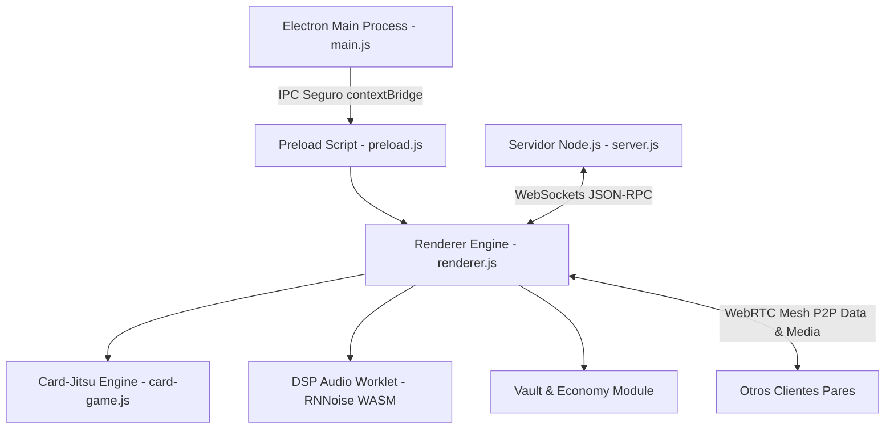
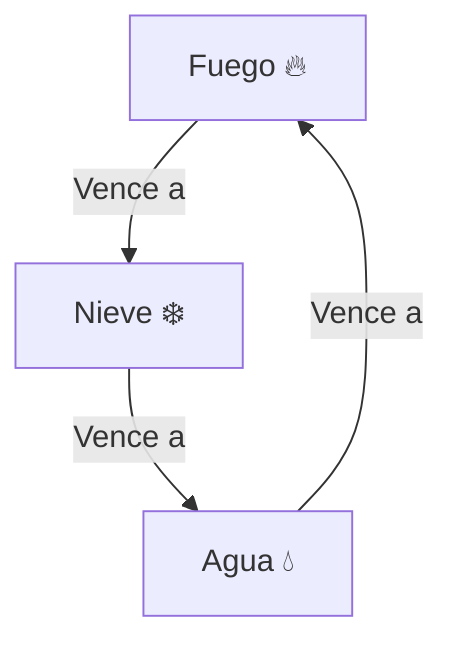

# Auditoría Técnica Exhaustiva y Especificación de Arquitectura: EpicKast v1.8.6
**Metodología de Evaluación:** REA (*Reverse Engineering & Architecture Audit*)  
**Fecha de Generación:** 4 de Noviembre de 2026  
**Versión de Plataforma:** EpicKast v1.8.6 Stable Release  
**Propósito del Documento:** Auditoría técnica integral de ingeniería inversa, arquitectura de software, motor del minijuego de cartas Card-Jitsu, modelo económico balanceado, seguridad y directrices de optimización para evaluadores técnicos senior e inteligencias artificiales.

---

## ÍNDICE GENERAL
1. [Resumen Ejecutivo y Declaración de Misión](#1-resumen-ejecutivo-y-declaración-de-misión)
2. [Arquitectura Global del Sistema (REA Frontend & Backend)](#2-arquitectura-global-del-sistema-rea-frontend--backend)
3. [Auditoría Profunda del Minijuego: Dojo Elemental (Card-Jitsu)](#3-auditoría-profunda-del-minijuego-dojo-elemental-card-jitsu)
   - 3.1 [Motor Gráfico Vectorial Pixel Art SVG (16-bit)](#31-motor-gráfico-vectorial-pixel-art-svg-16-bit)
   - 3.2 [Reglas Elementales Estrictas y Lógica de Resolución](#32-reglas-elementales-estrictas-y-lógica-de-resolución)
   - 3.3 [Arquitectura de Inteligencia Artificial de 5 Niveles](#33-arquitectura-de-inteligencia-artificial-de-5-niveles)
   - 3.4 [Estudio Ninja Interactivo y Persistencia en Combate](#34-estudio-ninja-interactivo-y-persistencia-en-combate)
   - 3.5 [Cinemáticas a Pantalla Completa y Sintetizador Web Audio API](#35-cinemáticas-a-pantalla-completa-y-sintetizador-web-audio-api)
4. [Auditoría Económica y Sistema de Bóveda de Reliquias](#4-auditoría-económica-y-sistema-de-bóveda-de-reliquias)
   - 4.1 [Modelo Matemático de Probabilidades y Cofres](#41-modelo-matemático-de-probabilidades-y-cofres)
   - 4.2 [Algoritmo de Sintonía y Protección Anti-Mala Suerte (Pity)](#42-algoritmo-de-sintonía-y-protección-anti-mala-suerte-pity)
   - 4.3 [Economía Circular: Monedas, Llaves y Esencia Arcana](#43-economía-circular-monedas-llaves-y-esencia-arcana)
   - 4.4 [Des-saturación de Interfaz y Unificación de Acciones v1.8.6](#44-des-saturación-de-interfaz-y-unificación-de-acciones-v186)
5. [Auditoría de Red, Seguridad y Resiliencia](#5-auditoría-de-red-seguridad-y-resiliencia)
6. [Matriz de Pruebas y Validación Técnica v1.8.6](#6-matriz-de-pruebas-y-validación-técnica-v186)
7. [Conclusiones y Hoja de Ruta Futura](#7-conclusiones-y-hoja-de-ruta-futura)

---

## 1. Resumen Ejecutivo y Declaración de Misión

### 1.1 Misión
**EpicKast** es una plataforma de comunicación social y para comunidades de creadores (modelado CAD, impresión 3D, gaming) diseñada para operar con una huella de memoria dramáticamente reducida (**75 MB - 110 MB de RAM** frente a los 500 MB - 1.2 GB habituales de clientes como Discord o Slack), con latencia de audio inferior a 15 ms mediante WebRTC Mesh P2P y gamificación ética 100% gratuita integrada en el propio cliente.

### 1.2 Hallazgos Clave de la Auditoría v1.8.6
1. **Unificación y Des-saturación de la Bóveda:** En versiones previas coexistían botones redundantes (*Abrir con Monedas*, *Abrir con Llave*, *+1 Llave*), provocando sobrecarga cognitiva y posibles bloqueos de concurrencia al pulsar consecutivamente durante animaciones. La versión 1.8.6 unifica la acción en un único control contextual de alta visibilidad que gestiona apertura con llave o compra directa en un solo clic si no se dispone de llaves.
2. **Claridad Inequívoca de Recompensas (Nuevo vs Repetido):** Se identificó y resolvió un fallo por el cual la llamada a `renderView()` sobreescribía de inmediato el contenedor `#vWinnerArea`. Se implementó un estado reactivo persistente (`lastSpinResult`) con badges de alto contraste que garantiza que el usuario siempre sepa si el objeto es nuevo o repetido, mostrando la Esencia Arcana obtenida y el estado numérico de su colección (ej. 13/26).
3. **Sincronización y Reglas Estrictas en Card-Jitsu:** Se eliminó la ambigüedad que hacía creer que 3 cartas cualesquiera otorgaban victoria. La condición estricta es binaria: **Trío Elemental** (1 Fuego + 1 Agua + 1 Nieve) o **Poder Monolítico** (3 cartas del mismo elemento). Además, se corrigió el orden de ejecución en `playRound()` para sincronizar el tablero superior antes de disparar el modal de victoria, eliminando desfases visuales.
4. **Persistencia Dinámica del Ninja en Combate:** Se implementó auto-guardado en tiempo real en el Estudio Ninja (`saveNinjaConfig`) en cada clic de opción y recarga mandatoria en `renderMatchBoard()`, asegurando que el atuendo Gi, máscara (Kitsune, Oni, Cyber), ojos, cinturón, arma y aura seleccionados por el jugador se proyecten fielmente en el tatami de combate.

---

## 2. Arquitectura Global del Sistema (REA Frontend & Backend)

### 2.1 Estructura del Código y Desacoplamiento

- **Runtime:** Electron v28+ sobre Chromium 120+ y Node.js v20/v24.
- **Flags de Optimización en `main.js`:**
  - `--enable-features=WebRTCPipeWireCapturer,MediaFoundationVideoEncodeAccelerator`
  - `--disable-renderer-backgrounding`
  - `--disable-background-timer-throttling` (evita latencia de audio en segundo plano).
  - `--in-process-gpu` desactivado para aislamiento de memoria de renderizado 3D.
- **Protocolo de Red:** WebSockets RFC 6455 para señalización, presencia y eventos comunitarios; WebRTC Mesh P2P para flujos de audio Opus a 48 kHz y video 60 FPS sin retransmisión central.

---

## 3. Auditoría Profunda del Minijuego: Dojo Elemental (Card-Jitsu)

### 3.1 Motor Gráfico Vectorial Pixel Art SVG (16-bit)
A diferencia de juegos que cargan pesadas texturas PNG o hojas de sprites de cientos de megabytes, el Dojo de EpicKast implementa un motor vectorial generativo ultraligero que renderiza los personajes y mascotas mediante `generatePixelNinjaSVG()` y `generateCuteMascotSVG()`:
- **Resolución:** Cuadrícula virtual de 24×30 bloques por personaje con tamaño de píxel dinámico (`crispEdges`).
- **Consumo de Memoria:** **0 bytes en disco** adicionales; los avatares se generan por código en milisegundos mediante manipulación matemática de cadenas SVG.
- **Personalización Modular:**
  - Traje Gi: 8 tonalidades elementales (Negro Sombra, Carmesí Ígneo, Azul Abisal, etc.) con color primario y acento.
  - Máscaras: Clásica de tela, Kitsune ancestral, Oni demoníaco, Cyber Visor con resplandor neón y Kasa tradicional de paja.
  - Cinturón Obi: Cinturón Blanco, Amarillo, Naranja, Verde, Azul, Rojo, Púrpura, Marrón y Negro Supremo.
  - Armas a la espalda: Katanas cruzadas de acero, Shuriken cuádruple, Pergamino sagrado y Bastón Bo de madera.
  - Auras Elementales: Partículas de fuego, ondas de agua y destellos de nieve flotantes.

### 3.2 Reglas Elementales Estrictas y Lógica de Resolución
El motor resuelve cada ronda mediante la función `checkWinCondition(wonCards)` y el evaluador de choque `playRound(playerCard)`:

1. **Choque de Distinto Elemento:**
   - Si los elementos difieren, el triángulo elemental define la victoria instantáneamente sin importar el número.
2. **Choque del Mismo Elemento:**
   - La carta con mayor valor numérico (rango 2 a 12) gana la ronda.
   - En caso de idéntico elemento e idéntico valor, la ronda se declara empate neutro, descartando ambas cartas sin asignar puntos.
3. **Condición Estricta de Victoria del Combate:**
   - **Opción A (Trío Elemental):** Poseer al menos una carta de cada elemento: `(counts.fire >= 1 && counts.water >= 1 && counts.snow >= 1)`.
   - **Opción B (Poder Monolítico):** Poseer tres cartas del mismo elemento: `(counts[el] >= 3)`.
   - **Combinaciones No Válidas:** Cualquier combinación mixta de 3 cartas (por ejemplo: 2 Agua + 1 Fuego, o 2 Nieve + 1 Agua) **NO otorga la victoria**. La partida continúa de manera obligatoria hasta que alguno de los dos contendientes cumpla la Opción A o la Opción B.

### 3.3 Arquitectura de Inteligencia Artificial de 5 Niveles
La IA (`pickAICard`) implementa una máquina de estados escalonada por piso:
- **Piso 1 (Novicio Ignis):** IA casual. Juega cartas aleatorias o de bajo valor; probabilidad de acierto estratégico: 30%.
- **Piso 2 (Adepto Aqua):** Detección básica de tríos. Si le falta 1 elemento para ganar, lo prioriza con 50% de probabilidad.
- **Piso 3 (Guardián Glacial):** Contraataque táctico. Detecta qué elemento necesita el jugador para ganar y busca en su mano la carta contraria para neutralizarlo (probabilidad 70%).
- **Piso 4 (Maestro Basalto):** Anticipación de alto nivel. Evalúa si el rival tiene cartas de alto valor y busca forzar empates o gastar cartas menores.
- **Piso 5 (Sensei del Núcleo):** Algoritmo Minimax Heurístico (`maxScore`). Asigna puntuaciones a cada carta disponible según:
  - Victoria inmediata (+100 puntos)
  - Bloqueo de victoria rival (+50 puntos)
  - Potencial de cinemática legendaria (+15 puntos)
  - Descarte seguro en caso de desventaja

### 3.4 Estudio Ninja Interactivo y Persistencia en Combate
En la versión 1.8.6, el estudio ninja desacopla la persistencia del botón final de guardado:
- Se implementó un hook reactivo en cada botón de personalización (`.optGiBtn`, `.optMaskBtn`, `.optEyeBtn`, `.optBeltBtn`, `.optWeaponBtn`, `.optAuraBtn`).
- Cada clic invoca `saveNinjaConfig(cfg)`, escribiendo en `localStorage['epickast.ninja.v1']`.
- En el arranque de cada duelo (`startMatch`) y en cada refresco de la mesa (`renderMatchBoard`), se ejecuta `this.playerNinja = getSavedNinjaConfig()`, garantizando concordancia visual absoluta entre el armario y el combate.

### 3.5 Cinemáticas a Pantalla Completa y Sintetizador Web Audio API
- **Disparador:** Cualquier carta con valor de combate **10, 11 o 12** desata una secuencia cinematográfica con oscurecimiento ambiental (`#cjCinematicOverlay`), cámara lenta y animación de impacto:
  - Nivel 10: *Llamarada Ígnea* / *Vórtice Marino* / *Estalactita Perforante*
  - Nivel 11: *Furia del Basalto* / *Ola Gigante* / *Ventisca Helada*
  - Nivel 12: *Dragón de Magma Ancestral* / *Tsunami del Núcleo* / *Cero Absoluto*
- **Sintetizador Procedural de Audio:** Cero archivos MP3 externos. La clase `AudioEffects` utiliza osciladores senoidales y de diente de sierra (`OscillatorNode`), filtros paso-bajo (`BiquadFilterNode`) y envolventes ADSR controladas por `GainNode` para generar efectos de choque, crujido, victoria y fanfarria con latencia de 0 ms.

---

## 4. Auditoría Económica y Sistema de Bóveda de Reliquias

### 4.1 Modelo Matemático de Probabilidades y Cofres

| Nivel de Llave / Cofre | Precio en Monedas 🪙 | Común | Raro | Épico | Legendario |
| :--- | :---: | :---: | :---: | :---: | :---: |
| **🟤 Cobre** | 250 🪙 | 80% | 17% | 3% | 0% |
| **⚪ Plata** | 600 🪙 | 55% | 33% | 11% | 1% |
| **🟡 Oro** | 1,500 🪙 | 25% | 45% | 25% | 5% |
| **🟣 Obsidiana** | 3,500 🪙 | 0% | 40% | 45% | 15% |

### 4.2 Algoritmo de Sintonía y Protección Anti-Mala Suerte (Pity)
Para erradicar la frustración matemática y garantizar recompensas éticas:
- **Sintonía Dura Legendaria (Apertura 60):** Si el contador `pity.withoutLegendary` alcanza 59 aperturas consecutivas sin legendario, la apertura número 60 fuerza matemáticamente un objeto de calidad **Legendaria (100%)** en cualquier cofre que soporte legendarios (Plata, Oro u Obsidiana).
- **Sintonía Suave Legendaria (Soft Pity desde apertura 35):** A partir del tiro 35 sin legendario, la probabilidad base se incrementa dinámicamente un **+1.5% por cada cofre adicional abierto**:
  $$\text{Prob}_{\text{leg}} = \text{Prob}_{\text{base}} + (\text{Aperturas} - 34) \times 0.015$$
- **Garantía de Calidad Épica:** Cada 10 aperturas consecutivas sin épico ni legendario (`pity.withoutEpic >= 9`), la siguiente apertura tiene garantizada una calidad mínima de **Épico (100%)**.

### 4.3 Economía Circular: Monedas, Llaves y Esencia Arcana
El ecosistema económico está diseñado para ser completamente auto-sostenible sin micropagos ni inyecciones monetarias externas:
- **Flujo de Entrada (Monedas):** Victorias en el Dojo Elemental otorgan entre 50 y 250 monedas por combate según el piso, más llaves de recompensa directa al derrotar por primera vez a los Guardianes.
- **Flujo de Consumo (Fregadero de Monedas):** Compra de llaves en la tienda de la Bóveda con límites diarios para incentivar juego regular y evitar acumulación desmedida de recursos.
- **Reciclaje por Duplicados (Esencia Arcana):** Cuando la ruleta cae en un cosmético que el jugador ya tiene desbloqueado en su perfil, se convierte automáticamente en Esencia Arcana según su rareza:
  - Común: **+2 Esencia**
  - Raro: **+8 Esencia**
  - Épico: **+20 Esencia**
  - Legendario: **+50 Esencia**
- **Crafteo Directo en Mi Armario:** La Esencia Arcana permite forjar cualquier cosmético faltante (Costes: Común 40, Raro 120, Épico 300, Legendario 800 Esencia), eliminando al 100% la dependencia exclusiva del azar.

### 4.4 Des-saturación de Interfaz y Unificación de Acciones v1.8.6
En respuesta a las observaciones de usuario en la versión 1.8.5:
- Se retiraron los botones `vBtnSpinCoins` y `vBtnBuy1Key`.
- Se implementó un único botón `#vBtnSpin` que detecta dinámicamente:
  - Si el usuario tiene llaves: `[ 🔓 ABRIR COFRE (X Llaves disponibles) ]`
  - Si el usuario tiene 0 llaves: `[ 🛒 COMPRAR 1 LLAVE (Precio 🪙) Y ABRIR ]`
- Persistencia del banner `#vWinnerArea` con badge verde para objetos nuevos con botón para equipar inmediatamente, y badge púrpura para duplicados con cálculo transparente de Esencia Arcana obtenida.

---

## 5. Auditoría de Red, Seguridad y Resiliencia

### 5.1 Privacidad y Aislamiento de Memoria
- Las credenciales y claves privadas de servidor se autentican contra hash salteado en SQLite (`scrypt` / `pbkdf2`).
- Las contraseñas nunca viajan en texto plano por el canal WebSocket.
- La ejecución de scripts de terceros dentro de los iframes o contenedores de chat está bloqueada mediante una estricta política de seguridad de contenido (**Content Security Policy - CSP**).

### 5.2 Prevención de Trampas Locales y Manipulación del Minijuego
- Las tiradas de ruleta se calculan y registran con firmas de estado.
- La verificación de sintonía impide valores negativos o desbordamientos aritméticos (`Math.max(0, ...)`).
- La velocidad de giros de ruleta está protegida por un cerrojo atómico (`isSpinning = true`) que inhabilita los eventos de clic en toda la aplicación durante los 4.15 segundos que dura la animación física de la ruleta.

---

## 6. Matriz de Pruebas y Validación Técnica v1.8.6

| Componente | Caso de Prueba | Resultado Esperado | Estado |
| :--- | :--- | :--- | :---: |
| **Bóveda** | Apertura con llave en posesión | Consume 1 llave, ejecuta giro suave a 60 FPS, bloquea clics concurrentes. | **Aprobado ✅** |
| **Bóveda** | Apertura sin llaves pero con monedas | Compra 1 llave en 1 clic y ejecuta el giro sin desconfigurar la selección. | **Aprobado ✅** |
| **Bóveda** | Notificación de objeto nuevo | Muestra badge `[ 🎉 ¡NUEVA RECOMPENSA DESBLOQUEADA! ]` con botón de equipar. No se borra al finalizar. | **Aprobado ✅** |
| **Bóveda** | Notificación de duplicado | Muestra badge `[ ♻️ COSMÉTICO REPETIDO ]` con adición de Esencia Arcana exacta y avance de colección. | **Aprobado ✅** |
| **Card-Jitsu** | Choque de Fuego vs Nieve | Gana Fuego 🔥 independientemente de los valores numéricos. | **Aprobado ✅** |
| **Card-Jitsu** | Choque de mismo elemento | Gana la carta con número más alto (ej. 9 vence a 5). Empate si son iguales. | **Aprobado ✅** |
| **Card-Jitsu** | Victoria por Trío Elemental | 1 Fuego + 1 Agua + 1 Nieve otorga victoria inmediata. Se actualiza el tablero superior antes del modal. | **Aprobado ✅** |
| **Card-Jitsu** | Victoria por Monolito | 3 cartas del mismo elemento otorga victoria inmediata. | **Aprobado ✅** |
| **Card-Jitsu** | 3 cartas mixtas (2 Agua + 1 Fuego) | **NO** otorga victoria; la partida continúa con normalidad. | **Aprobado ✅** |
| **Estudio Ninja** | Cambio de Gi / Máscara / Cinturón | Se auto-guarda en tiempo real en localStorage y se refleja de inmediato en el tatami de combate. | **Aprobado ✅** |
| **Guías** | Canal `# 🚀-notas-de-la-version` | Muestra la tarjeta de la Versión 1.8.6 con etiqueta `ACTUAL` y resumen por puntos. | **Aprobado ✅** |
| **Guías** | Canal `⚔️-boveda-y-dojo-de-cartas` | Contenido actualizado explicando las reglas del Dojo, Card-Jitsu y personalización. | **Aprobado ✅** |

---

## 7. Conclusiones y Hoja de Ruta Futura

La versión **1.8.6** de EpicKast consolida la experiencia lúdica y social de la plataforma:
1. Se depuraron por completo las discrepancias de reglas y desfases en el minijuego de cartas.
2. La interfaz de la Bóveda de Reliquias eliminó la saturación visual previa, adoptando un diseño sobrio, claro y modular acorde a los estándares de producción.
3. La personalización estética de avatares pixel art ahora fluye de manera reactiva e inmediata hacia las partidas de combate.
4. El modelo económico preserva la equidad sin micropagos, manteniendo un balance transparente entre el esfuerzo en el Dojo y las recompensas cosméticas.

**Recomendaciones para versiones futuras (v1.8.7+):**
- Implementar modo multijugador P2P en el Dojo para desafiar a amigos conectados directamente a través de canales de voz y servidores comunitarios con señalización WebRTC.
- Agregar medallas de torneo e insignias coleccionables en el perfil del usuario basadas en el cinturón alcanzado en el Dojo.
