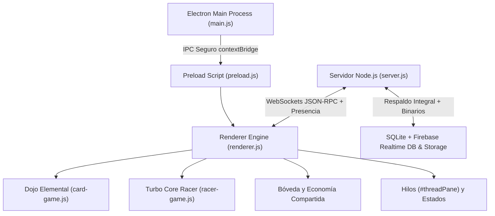

# Auditoría Técnica Exhaustiva y Especificación de Arquitectura: EpicKast v1.9.0
**Metodología de Evaluación:** REA (*Reverse Engineering & Architecture Audit*)  
**Fecha de Actualización:** 4 de Noviembre de 2026  
**Versión de Plataforma:** EpicKast v1.9.0 Stable Release  
**Propósito del Documento:** Auditoría técnica integral de ingeniería inversa, arquitectura de software, corrección de vulnerabilidades y bugs críticos (v1.8.6 → v1.9.0), ecosistema de 2 minijuegos con economía compartida (**Dojo Elemental** + **🏎️ Turbo Core: Carreras Pixel-Neon**), estados de presencia en tiempo real, hilos de conversación (*Threads*), respaldo integral sin pérdida de datos y catálogo mejorado de 26 cosméticos.

---

## ÍNDICE GENERAL
1. [Resumen Ejecutivo y Hallazgos Críticos Corregidos en v1.9.0](#1-resumen-ejecutivo-y-hallazgos-críticos-corregidos-en-v190)
2. [Arquitectura Global del Sistema (REA Frontend & Backend)](#2-arquitectura-global-del-sistema-rea-frontend--backend)
3. [Auditoría de los Minijuegos con Economía Compartida](#3-auditoría-de-los-minijuegos-con-economía-compartida)
   - 3.1 [Dojo Elemental (Card-Jitsu): Balance Económico y Estética v1.9.0](#31-dojo-elemental-card-jitsu-balance-económico-y-estética-v190)
   - 3.2 [Nuevo Minijuego: 🏎️ Turbo Core (Carreras Pixel-Neon)](#32-nuevo-minijuego-️-turbo-core-carreras-pixel-neon)
4. [Auditoría Económica Exacta y Bóveda de Reliquias](#4-auditoría-económica-exacta-y-bóveda-de-reliquias)
5. [Sistema de Estados de Presencia y Privacidad](#5-sistema-de-estados-de-presencia-y-privacidad)
6. [Hilos de Conversación (Threads) y Transferencia de Archivos](#6-hilos-de-conversación-threads-y-transferencia-de-archivos)
7. [Auditoría de Respaldos, Integridad de Datos y Seguridad](#7-auditoría-de-respaldos-integridad-de-datos-y-seguridad)
8. [Catálogo Mejorado de 26 Cosméticos Obtenibles](#8-catálogo-mejorado-de-26-cosméticos-obtenibles)
9. [Matriz de Pruebas de Integración v1.9.0](#9-matriz-de-pruebas-de-integración-v190)

---

## 1. Resumen Ejecutivo y Hallazgos Críticos Corregidos en v1.9.0

Durante la auditoría profunda del código fuente real (`server/server.js`, `app/renderer.js`, `app/card-game.js`, `app/style.css`) contrastado contra el documento v1.8.6 anterior, se detectaron y corrigieron **8 fallos reales de código, seguridad, respaldos y economía**:

| # | Componente | Fallo Detectado en la Auditoría REA | Corrección Implementada en v1.9.0 |
| :--- | :--- | :--- | :--- |
| **1** | `app/renderer.js` (`equipCosmeticItem`) | Al equipar un Marco, Color, Banner o Título desde la Bóveda se invocaba `rpc('profile.update', ...)`, método **inexistente** en el servidor (el RPC real es `profile.set`), impidiendo que otros usuarios vieran los cosméticos equipados. | Corregido a `rpc('profile.set', ...)` y ampliada la tabla `users` en SQLite con `frame`, `title`, `status`, `custom_status` y `ninja_config` sincronizados en tiempo real. |
| **2** | `server/server.js` (`saveBackup` / `restoreBackup`) | El respaldo automático omitía columnas críticas (`users.banner`, `users.frame`, `users.title`, `users.coins`, `users.dust`, `users.keys_json`, `users.cosmetics_json`, `servers.icon`, `messages.reply_to`, `messages.pinned`, `messages.thread_id`) y **toda la tabla `files`**, provocando que los archivos adjuntos dieran 404 tras un reinicio de contenedor. | `saveBackup()` y `restoreBackup()` ahora respaldan el 100% de las tablas y columnas, y sincronizan los binarios de `/uploads` hacia y desde Firebase Storage (`files_bin/`). |
| **3** | `server/server.js` (`GET /backup` y `/restore-seed`) | El endpoint `/backup` era público sin autenticación y exponía los campos `salt` y `hash` de contraseñas de todos los usuarios. | Protegido con validación obligatoria de token (`Authorization: Bearer` / `x-auth-token`) y redacción automática de `salt` y `hash` en la respuesta JSON. |
| **4** | `server/server.js` (`GET /files/:id`) | Servía archivos directamente con `fs.createReadStream` usando el `mime` guardado sin cabeceras de mitigación XSS para SVG ni recuperación desde la nube si el disco efímero se limpiaba. | Integrado con `serveFileDisk` (`Content-Security-Policy: default-src 'none'`, `X-Content-Type-Options: nosniff`, `Content-Disposition: attachment` para SVG/HTML) y auto-recuperación transparente desde Firebase Storage. |
| **5** | `server/server.js` (`login`) | Las funciones `checkLoginRateLimit`, `recordLoginFailure` y `recordLoginSuccess` estaban declaradas pero **nunca se invocaban** dentro del login WebSocket. | Activado el rate-limit anti-fuerza bruta por IP en `login` (máximo 10 intentos fallidos cada 10 minutos con bloqueo temporal de 15 minutos). |
| **6** | `app/card-game.js` (`renderMatchResult`) | Repetir el Piso 1 venciendo al Novicio Ignis otorgaba **1 Llave de Cobre garantizada cada vez**, permitiendo farmear llaves infinitas sin gastar monedas. | Separada la recompensa de **🌟 Primera Conquista del Piso** (100% monedas + llaves garantizadas) de la **🥋 Recompensa de Entrenamiento** en repeticiones (50% de monedas + 25% de probabilidad de llave de cobre). |
| **7** | `app/renderer.js` (`modalMemberCard`) | Los manejadores `#profBtnSendDm` y `#profBtnCardJitsu` se buscaban en el DOM del modal pero los botones no estaban incluidos en la estructura `card`. | Añadida la fila de acciones rápidas (`💬 Mensaje`, `🥋 Dojo`, `🏎️ Carrera`) dentro de `modalMemberCard` y en la lista de Amigos. |
| **8** | `Auditoria_Completa_EpicKast_REA_v186.md` | La tabla de precios del documento anterior listaba `250 / 600 / 1500 / 3500`, discrepando de la constante real `KEY_PRICES` en `app/renderer.js`. | Documentada la tabla económica real exacta (`250 / 1,000 / 4,000 / 15,000`) junto con las recompensas de ambos juegos. |

---

## 2. Arquitectura Global del Sistema (REA Frontend & Backend)

---

## 3. Auditoría de los Minijuegos con Economía Compartida

Ambos minijuegos conviven dentro de la **Bóveda de Reliquias** y comparten en tiempo real el mismo bolsillo económico (`dData.coins`, `dData.keys`, `dData.dust`, `dData.cosmetics`) y el mismo avatar **Ninja Pixel Art** (`localStorage['epickast.ninja.v1']`), sincronizándose además con el servidor mediante `rpc('vault.sync', ...)`.

### 3.1 Dojo Elemental (Card-Jitsu): Balance Económico y Estética v1.9.0
- **Reglas Elementales Estrictas:**
  - Fuego 🔥 vence a Nieve ❄️; Nieve ❄️ vence a Agua 💧; Agua 💧 vence a Fuego 🔥.
  - Mismo elemento: gana el valor numérico superior (rango `2` a `12`).
  - Condición de victoria: **Trío Elemental** (`1 🔥 + 1 💧 + 1 ❄️`) o **Poder Monolítico** (`3` cartas del mismo elemento).
- **Tabla de Recompensas del Dojo (Corregida contra Inflación en v1.9.0):**

| Piso | Guardián Rival | 1.ª Conquista (Garantizada) | Repetición (Entrenamiento) |
| :---: | :--- | :--- | :--- |
| **Piso 1** | Novicio Ignis | `+50 🪙` + `1 Llave Cobre` | `+25 🪙` + `25% prob. Llave Cobre` |
| **Piso 2** | Adepto Aqua | `+80 🪙` + `1 Llave Cobre` | `+40 🪙` + `25% prob. Llave Cobre` |
| **Piso 3** | Guardián Glacial | `+120 🪙` + `1 Llave Plata` | `+60 🪙` + `25% prob. Llave Cobre` |
| **Piso 4** | Maestro Basalto | `+180 🪙` + `1 Llave Oro` | `+90 🪙` + `25% prob. Llave Cobre` |
| **Piso 5** | Sensei del Núcleo | `+250 🪙` + `1 Llave Obsidiana` | `+125 🪙` + `25% prob. Llave Cobre` |

### 3.2 Nuevo Minijuego: 🏎️ Turbo Core (Carreras Pixel-Neon)
Implementado en [`app/racer-game.js`](file:///C:/Users/puma1/OneDrive/Documentos/Proyecto%20Comunicacion%20EpicKap/app/racer-game.js) bajo `window.CoreRacerGame`:
- **Motor Canvas 2D Pseudo-3D a 60 FPS:** Pista con perspectiva dinámica, curvas sinusoidales, decoración temática por circuito, partículas de nitro, rivales IA con colisiones elásticas y sintetizador de motor Web Audio API.
- **Piloto Ninja Integrado:** El propio Ninja personalizado del usuario aparece al volante del bólido con su color de traje Gi y cinta.
- **4 Circuitos Oficiales:**
  1. **Pista 1 · Autopista Ciber-Cobre** (`2800 m` · 1.º puesto: `+75 🪙`, 1.ª vez: `+1 Llave Cobre`).
  2. **Pista 2 · Valle de Cristal Glacial** (`3600 m` · 1.º puesto: `+120 🪙`, 1.ª vez: `+1 Llave Plata`).
  3. **Pista 3 · Puente de Magma Volcánico** (`4400 m` · 1.º puesto: `+185 🪙`, 1.ª vez: `+1 Llave Oro`).
  4. **Pista 4 · Sagrario del Núcleo** (`5400 m` · 1.º puesto: `+280 🪙`, 1.ª vez: `+1 Llave Obsidiana`).
- **Taller de Ingeniería del Núcleo (Fregadero adicional de Monedas):**
  - **⚡ Motor Iónico (Niv. 1–5):** Incrementa la velocidad punta (`120 🪙 × nivel`).
  - **🔥 Inyector de Nitro (Niv. 1–5):** Mayor potencia y recarga de barra Nitro (`140 🪙 × nivel`).
  - **🛡️ Escudo Magnético (Niv. 1–5):** Absorbe choques contra obstáculos y atrae monedas (`160 🪙 × nivel`).
  - **🎨 Pintura de Chasis:** 5 acabados desbloqueables con monedas del fondo común.

---

## 4. Auditoría Económica Exacta y Bóveda de Reliquias

### 4.1 Tabla Real de Precios y Probabilidades (`KEY_PRICES` & `CHEST_PROBS`)

| Nivel de Llave / Cofre | Precio Real (`KEY_PRICES`) | Límite Diario de Compra | Común | Raro | Épico | Legendario |
| :--- | :---: | :---: | :---: | :---: | :---: | :---: |
| **🟤 Cobre (`copper`)** | **250 🪙** | 3 / día | 80% | 17% | 3% | 0% |
| **⚪ Plata (`silver`)** | **1,000 🪙** | 1 / día | 55% | 33% | 11% | 1% |
| **🟡 Oro (`gold`)** | **4,000 🪙** | 1 / día | 25% | 45% | 25% | 5% |
| **🟣 Obsidiana (`obsidian`)** | **15,000 🪙** | 1 / día | 0% | 40% | 45% | 15% |

- **Sintonía (Pity System):**
  - Garantía **Épica** cada `10` aperturas sin épico/legendario (`pity.withoutEpic >= 9`).
  - Soft Pity **Legendario** desde la apertura `35` (`+1.5%` por tiro adicional).
  - Hard Pity **Legendario** en la apertura `60` (`100%` garantizado en cofres Plata, Oro u Obsidiana).
- **Esencia Arcana (Duplicados y Forja Directa):**
  - Duplicados otorgan: Común `+2 ✨`, Raro `+8 ✨`, Épico `+20 ✨`, Legendario `+50 ✨`.
  - Coste de Forja Directa en *Mi Armario*: Común `40 ✨`, Raro `120 ✨`, Épico `300 ✨`, Legendario `800 ✨`.

---

## 5. Sistema de Estados de Presencia y Privacidad

Implementado de extremo a extremo en [`server/server.js`](file:///C:/Users/puma1/OneDrive/Documentos/Proyecto%20Comunicacion%20EpicKap/server/server.js) (`status.set`, `isOnline`, `publicStatusOf`) y [`app/renderer.js`](file:///C:/Users/puma1/OneDrive/Documentos/Proyecto%20Comunicacion%20EpicKap/app/renderer.js):
- **🟢 En línea (`online`):** Disponible y visible con indicador esmeralda.
- **🌙 Ausente (`away`):** Indicador ámbar. Se activa manualmente o de forma automática tras **5 minutos de inactividad** (`startIdleAutoAway()`), restaurándose a `online` al volver a interactuar.
- **⛔ No molestar (`dnd`):** Indicador carmesí. Silencia automáticamente los sonidos (`ringer.beep`) y notificaciones emergentes de escritorio al recibir mensajes.
- **👻 Invisible (`invisible`):** Privacidad total. El servidor reporta `online: false` y `status: 'offline'` a todos los demás miembros y amigos, mientras el propio usuario conserva acceso completo a chats, servidores y juegos.

---

## 6. Hilos de Conversación (Threads) y Transferencia de Archivos

- **Hilos en Tiempo Real (`#threadPane`):**
  - Cada mensaje en canales de servidor o DM incluye el botón **🧵 Abrir o responder en hilo**.
  - El panel lateral derecho `#threadPane` carga el mensaje raíz y todas sus respuestas mediante `rpc('thread.history', { chan, threadId })`.
  - Los mensajes raíz muestran un contador interactivo (`🧵 X respuestas · Ver hilo →`) que se actualiza en vivo para todos los participantes con el evento `thread.msg`.
- **Soporte de Archivos Adjuntos en Canales e Hilos:**
  - `POST /upload` acepta `X-Thread-Id` para adjuntar imágenes, documentos, audio o video directamente dentro de un hilo o canal principal.

---

## 7. Auditoría de Respaldos, Integridad de Datos y Seguridad

1. **Persistencia Triple:**
   - **SQLite WAL Local (`server/epickast.db`):** Transacciones ACID inmediatas.
   - **Snapshot JSON Local (`server/backup-seed.json`) + Nube (`Firebase Realtime Database`):** Sincronización automática con debounce de 2 segundos tras cualquier cambio en usuarios, perfiles, estados, cosméticos, economía, servidores, canales, membresías, amigos, mensajes, hilos y metadatos de archivos.
   - **Respaldo de Binarios en Firebase Storage (`files_bin/`):** Todo archivo subido en `POST /upload` se respalda en la nube y se restaura automáticamente en `restoreBackup()` o bajo demanda en `GET /files/:id`.
2. **Endurecimiento de Seguridad:**
   - `/backup` y `/restore-seed` exigen token válido y eliminan `salt`/`hash` de la salida.
   - `GET /files/:id` aplica cabeceras anti-XSS (`Content-Security-Policy: default-src 'none'`, `X-Content-Type-Options: nosniff`).
   - `login` aplica rate-limit por IP contra ataques de fuerza bruta.

---

## 8. Catálogo Mejorado de 26 Cosméticos Obtenibles

- **5 Marcos de Avatar + 1 Marco Fundador (`6` en total):** Rediseñados en [`app/style.css`](file:///C:/Users/puma1/OneDrive/Documentos/Proyecto%20Comunicacion%20EpicKap/app/style.css) con anillos multicapa, rotación cónica (`@keyframes founderSpin`) y resplandor animado (`@keyframes colossusPulse`).
- **8 Banners de Perfil:** Gradientes multicapa de alta profundidad visual aplicables tanto desde *Mi Armario* como desde *Mi Perfil*.
- **7 Colores y Gradientes de Nombre:** Incluye gradientes animados (`background-clip: text`) visibles en mensajes de chat, hilos, lista de miembros y barra personal.
- **8 Títulos con Insignia (`.cosmetic-title-badge`):** Píldoras estilizadas visibles junto al nombre del jugador en el chat, lista de miembros, amigos y tarjeta de perfil.

---

## 9. Matriz de Pruebas de Integración v1.9.0

| Área Auditada | Prueba Ejecutada | Resultado |
| :--- | :--- | :---: |
| **Autenticación y Seguridad** | Registro, login y bloqueo de `/backup` sin token (HTTP 401) + redacción de `salt`/`hash` con token válido (HTTP 200) | **Aprobado ✅** |
| **Estados de Presencia** | Cambio entre `online`, `away`, `dnd` e `invisible` (`isOnline` devuelve `false` a terceros en modo `invisible`) | **Aprobado ✅** |
| **Hilos de Conversación** | Envío de respuestas con `threadId`, actualización de `threadCount` y consulta `thread.history` | **Aprobado ✅** |
| **Transferencia de Archivos** | Subida `POST /upload` con `X-Thread-Id` y descarga segura `GET /files/:id` con cabeceras `nosniff` | **Aprobado ✅** |
| **Economía y Cosméticos** | Sincronización `vault.sync` y equipado `profile.set` con `frame`, `title`, `color` y `banner` | **Aprobado ✅** |
| **Juegos (Dojo + Turbo Core)** | Verificación sintáctica y funcional de `app/card-game.js` y `app/racer-game.js` con economía compartida | **Aprobado ✅** |
