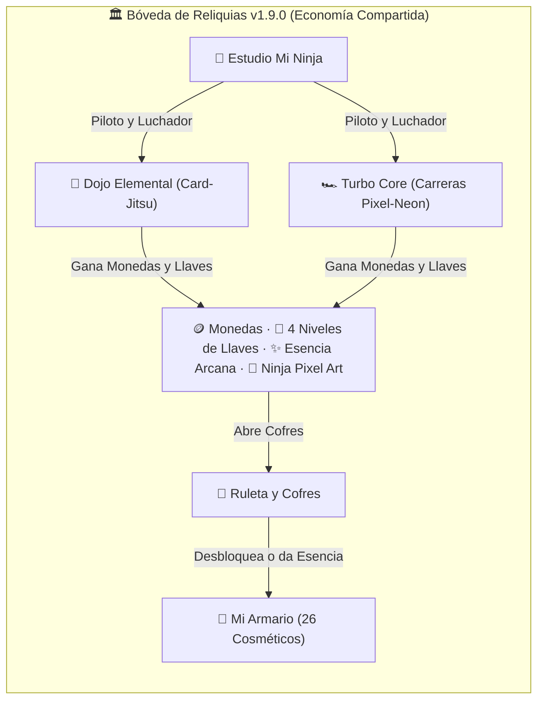

# 🏛️ Resumen Completo de la Bóveda de Reliquias, Estética Visual y Minijuegos (EpicKast v1.9.0)

**Fecha:** 4 de Noviembre de 2026  
**Versión:** EpicKast `v1.9.0`  
**Archivos Fuente Principales:**
- Controlador de Bóveda y Armario: [`app/renderer.js`](file:///C:/Users/puma1/OneDrive/Documentos/Proyecto%20Comunicacion%20EpicKap/app/renderer.js) (`modalVault`, líneas `447–960`)
- Estilos y Animaciones Cosméticas: [`app/style.css`](file:///C:/Users/puma1/OneDrive/Documentos/Proyecto%20Comunicacion%20EpicKap/app/style.css) (líneas `1185–1280`)
- Minijuego 1 — Dojo Elemental (Card-Jitsu): [`app/card-game.js`](file:///C:/Users/puma1/OneDrive/Documentos/Proyecto%20Comunicacion%20EpicKap/app/card-game.js) (`window.CardJitsuGame`)
- Minijuego 2 — Turbo Core (Carreras Pixel-Neon): [`app/racer-game.js`](file:///C:/Users/puma1/OneDrive/Documentos/Proyecto%20Comunicacion%20EpicKap/app/racer-game.js) (`window.CoreRacerGame`)
- Respaldo del Juego Clásico de Mazmorras: [`app/dungeons-game-backup.js`](file:///C:/Users/puma1/OneDrive/Documentos/Proyecto%20Comunicacion%20EpicKap/app/dungeons-game-backup.js)

---

## 1. 🎨 Estética General y Arquitectura Visual de la Bóveda (`v1.9.0`)

La **Bóveda de Reliquias** fue rediseñada bajo una estética **Oscura Sobria Pixel-Neon (Dark Slate & Indigo)** para evitar la saturación de colores intensos de versiones anteriores:

- **Paleta Base del Contenedor:**
  - **Fondo Principal del Modal:** `#0f131d` con borde sutil `1px solid rgba(255, 255, 255, 0.08)` y sombra profunda `0 24px 70px rgba(0, 0, 0, 0.85)`.
  - **Cabecera Superior:** `#141926` con tipografía limpia (`#f8fafc` para títulos y `#94a3b8` para subtítulos).
  - **Sub-barra Económica:** `#111622` que agrupa en una sola línea las **Monedas (`🪙`)**, **Esencia Arcana (`✨`)**, **Sintonía (`⭐ X/60`)**, el inventario en vivo de las **4 llaves** y el botón desplegable **`🛒 Comprar Llaves con Monedas`**.
- **Dimensiones y Navegación:**
  - Ventana panorámica adaptable (`width: min(980px, 95vw)`, `height: min(760px, 90vh)`), con cierre mediante botón **`✕ Cerrar`** o tecla **`ESC`** (con limpieza automática de audio y bucles de juego).
  - **5 Pestañas Integradas en Cabecera:**
    1. `🎁 Ruleta y Cofres`
    2. `🎨 Mi Armario (X/26)`
    3. `🥋 Dojo Elemental`
    4. `🏎️ Turbo Core`
    5. `🥷 Mi Ninja`

---

## 2. 🎁 Pestaña 1: Ruleta, Cofres y Economía Circular

### 2.1 Diseño de la Ruleta y Control Único Des-saturado
- **Selector de 4 Cofres (`#vChestGrid`):** Tarjetas limpias en `#161c2a` con borde activo según el metal de la llave seleccionada:
  - **🟤 Cobre (`#d97706`)**
  - **⚪ Plata (`#94a3b8`)**
  - **🟡 Oro (`#eab308`)**
  - **🟣 Obsidiana (`#a855f7`)**
- **Pista de Giro Horizontal (`#vTrack`):** Carrusel de 42 casillas con física `cubic-bezier(0.12, 0.82, 0.18, 1)` de `4.0s` y línea central indicadora cian (`#38bdf8` con resplandor `0 0 12px`).
- **Botón Único Inteligente (`#vBtnSpin`):**
  - Si tienes llaves del cofre elegido: muestra en azul **`🔓 ABRIR COFRE (X Llaves disponibles)`**.
  - Si tienes `0` llaves: cambia automáticamente a verde **`🛒 COMPRAR 1 LLAVE (Precio 🪙) Y ABRIR`** (permite comprar y girar en un solo clic sin saturar de botones).
- **Banner Persistente de Resultado (`#vWinnerArea`):**
  - **Cosmético Nuevo:** Tarjeta esmeralda (`rgba(16, 185, 129, 0.14)`) con etiqueta **`🎉 ¡NUEVA RECOMPENSA DESBLOQUEADA!`** y botón **`✨ Equipar ahora`**.
  - **Cosmético Repetido:** Tarjeta púrpura (`rgba(168, 85, 247, 0.14)`) con etiqueta **`♻️ COSMÉTICO REPETIDO (YA EN TU ARMARIO)`** e indicación exacta de cuánta **Esencia Arcana (`+2 / +8 / +20 / +50 ✨`)** se sumó.

### 2.2 Tabla Matemática de Cofres, Precios y Probabilidades

| Nivel de Cofre / Llave | Precio en Tienda | Límite Diario | Común (`#94a3b8`) | Raro (`#38bdf8`) | Épico (`#c084fc`) | Legendario (`#facc15`) |
| :--- | :---: | :---: | :---: | :---: | :---: | :---: |
| **🟤 Cobre (`copper`)** | **250 🪙** | 3 / día | 80% | 17% | 3% | 0% |
| **⚪ Plata (`silver`)** | **1,000 🪙** | 1 / día | 55% | 33% | 11% | 1% |
| **🟡 Oro (`gold`)** | **4,000 🪙** | 1 / día | 25% | 45% | 25% | 5% |
| **🟣 Obsidiana (`obsidian`)** | **15,000 🪙** | 1 / día | 0% | 40% | 45% | 15% |

- **Sistema de Sintonía (Protección Anti-Mala Suerte):**
  - **Garantía Épica:** Cada `10` tiros sin obtener un artículo Épico o Legendario, el tiro 10 garantiza **Épico o superior (100%)**.
  - **Sintonía Suave Legendaria:** Desde el tiro `35` sin Legendario, aumenta **+1.5%** la probabilidad Legendaria por cada cofre adicional.
  - **Garantía Legendaria:** En el tiro `60` sin Legendario, garantiza **100% Legendario** (en cofres Plata, Oro u Obsidiana).

---

## 3. 🎨 Pestaña 2: Mi Armario y Catálogo Completo de 26 Cosméticos

El armario incluye filtros por categoría (`Todos (26)`, `🖼️ Marcos (5)`, `🏷️ Banners (7)`, `🎨 Colores (7)`, `👑 Títulos (7)`), barra de progreso de colección y sistema de **Forja Directa con Esencia Arcana** (`40 ✨` Común, `120 ✨` Raro, `300 ✨` Épico, `800 ✨` Legendario).

> **Nota:** Adicionalmente existe el marco especial de regalo de primera victoria **`founder_blue`** (*Marco Fundador del Núcleo*), con anillo cónico giratorio celeste-índigo (`@keyframes founderSpin`).

### 3.1 🖼️ Marcos de Avatar (5 de Colección + 1 Fundador)
Renderizados con anillos multicapa, sombras interiores y animaciones CSS en [`app/style.css`](file:///C:/Users/puma1/OneDrive/Documentos/Proyecto%20Comunicacion%20EpicKap/app/style.css#L1185-L1254):

| ID | Nombre | Rareza | Estética Visual y Efecto CSS |
| :--- | :--- | :---: | :--- |
| `founder_blue` | **★ Marco Fundador del Núcleo** | Especial | Anillo doble `#38bdf8` + pseudo-elemento `::after` con `conic-gradient` giratorio continuo (`4s`). |
| `frame-colossus-legend` | **★ Marco: Núcleo del Coloso** | 🟡 Legendario | Borde dorado `#fbbf24` con halo ígneo pulsante (`@keyframes colossusPulse`: oro `#f59e0b` y magma `#ef4444`). |
| `frame-runic` | **Marco: Partículas Rúnicas** | 🟣 Épico | Anillo carmesí-magenta (`#f43f5e` / `#ec4899`) con resplandor rúnico (`0 0 14px`). |
| `frame-amethyst` | **Marco: Cristal de Amatista** | 🔵 Raro | Cristal facetado violeta `#a855f7` con borde interior `#d8b4fe` y halo púrpura. |
| `frame-silver` | **Marco: Plata Rúnica** | 🔵 Raro | Acero bruñido `#e2e8f0` con bisel interior `#94a3b8` y brillo frío. |
| `frame-copper` | **Marco: Cobre Forjado** | 🔵 Raro | Bronce cálido `#d97706` con anillo interior `#fbbf24` de las Minas de Cobre. |

### 3.2 🏷️ Banners de Perfil (7 de Colección)
Se muestran en la tarjeta de perfil al hacer clic sobre un usuario en cualquier servidor y en el modal **Mi Perfil**:

| ID | Nombre | Rareza | Gradiente CSS Exacto |
| :--- | :--- | :---: | :--- |
| `banner_colossus_awakening` | **★ Banner: Despertar del Coloso** | 🟡 Legendario | `linear-gradient(135deg, #450a0a 0%, #b91c1c 45%, #f59e0b 100%)` |
| `banner_molten_lava` | **Banner: Lava Fundida** | 🟣 Épico | `linear-gradient(135deg, #7f1d1d 0%, #ea580c 50%, #facc15 100%)` |
| `banner_void_storm` | **Banner: Tormenta del Vacío** | 🟣 Épico | `linear-gradient(135deg, #090d16 0%, #3b0764 55%, #7e22ce 100%)` |
| `banner_magma_mines` | **Banner: Minas de Magma** | ⚪ Común | `linear-gradient(135deg, #27120b 0%, #7c2d12 100%)` |
| `banner_amethyst_galleries` | **Banner: Galerías de Amatista** | ⚪ Común | `linear-gradient(135deg, #1e1b4b 0%, #581c87 100%)` |
| `banner_ancestral_crypt` | **Banner: Cripta Ancestral** | ⚪ Común | `linear-gradient(135deg, #0f172a 0%, #334155 100%)` |
| `banner_lava_bridges` | **Banner: Puentes de Lava** | ⚪ Común | `linear-gradient(135deg, #431407 0%, #9a3412 100%)` |
| `banner_core_sanctum` | **Banner: Sagrario del Núcleo** | ⚪ Común | `linear-gradient(135deg, #111827 0%, #4f46e5 55%, #9333ea 100%)` |

### 3.3 🎨 Colores y Gradientes de Nombre (7 de Colección)
Aplicados mediante `nameColorStyle()` con soporte de texto degradado (`-webkit-background-clip: text`) en mensajes de chat, hilos, lista de miembros y barra inferior:

| ID | Nombre | Rareza | Color / Gradiente CSS |
| :--- | :--- | :---: | :--- |
| `color_aurora` | **Color: Aurora Boreal** | 🟣 Épico | `linear-gradient(90deg, #00e5ff, #a855f7)` |
| `color_volcanic_flame` | **Color: Fuego Volcánico** | 🟣 Épico | `linear-gradient(90deg, #ff3366, #ffb300)` |
| `color_amber` | **Color: Ámbar Volcánico** | ⚪ Común | `#f59e0b` |
| `color_amethyst` | **Color: Púrpura Amatista** | ⚪ Común | `#a855f7` |
| `color_emerald` | **Color: Verde Esmeralda** | ⚪ Común | `#10b981` |
| `color_cyan` | **Color: Cian Neón** | ⚪ Común | `#06b6d4` |
| `color_magma` | **Color: Rojo Magma** | ⚪ Común | `#ef4444` |

### 3.4 👑 Títulos con Insignia (7 de Colección)
Renderizados como píldoras `.cosmetic-title-badge` junto al nombre del usuario en el chat, hilos, lista de miembros, amigos y perfil:

| ID | Título Visible | Rareza | Estilo Visual de la Insignia |
| :--- | :--- | :---: | :--- |
| `title_colossus_slayer` | **`★ Coloso Carmesí`** | 🟡 Legendario | Fondo dorado-carmesí (`#f59e0b` → `#ef4444`), borde `#fbbf24`, texto `#fde047` con brillo dorado. |
| `title_abyss_guardian` | **`⚔️ Guardián del Abismo`** | 🟣 Épico | Fondo índigo-púrpura, borde `#818cf8`, texto `#e0e7ff`. |
| `title_rune_master` | **`✨ Maestro Rúnico`** | 🔵 Raro | Píldora arcana violeta-índigo con borde translúcido. |
| `title_flame_herald` | **`🔥 Heraldo de la Llama`** | 🔵 Raro | Píldora ígnea con icono elemental. |
| `title_core_explorer` | **`🧭 Explorador del Núcleo`** | ⚪ Común | Píldora táctica de explorador. |
| `title_shadow_hunter` | **`🗡️ Cazador de Sombras`** | ⚪ Común | Píldora sombría de cazador. |
| `title_crypt_sentinel` | **`🛡️ Centinela de la Cripta`** | ⚪ Común | Píldora defensiva de la cripta. |
| `title_novice_delver` | **`⛏️ Aventurero de las Minas`** | ⚪ Común | Píldora inicial de las minas. |

---

## 4. 🥋 Pestaña 3: Minijuego 1 — Dojo Elemental (Card-Jitsu Pixel Art)

Implementado en [`app/card-game.js`](file:///C:/Users/puma1/OneDrive/Documentos/Proyecto%20Comunicacion%20EpicKap/app/card-game.js):

### 4.1 Estética Visual del Dojo
- **Salón del Dojo (Lobby):**
  - Cabecera con vista previa en vivo de tu **Ninja Pixel Art**, contador de **`X/5 Pisos Dominados`** y acceso rápido a **`🎨 Personalizar Mi Ninja`**.
  - Tarjetas de los **5 Guardianes del Núcleo** con retratos ilustrados (`ignis.jpg`, `torrent.jpg`, `frost.jpg`, `basalt.jpg`, `sensei.jpg`), indicador de cinturón, estado (`✓ Dominado` o `🌟 1.ª Victoria`) y desglose claro de recompensas.
- **Tatami de Combate Pixel Art:**
  - Escenario interior japonés con columnas de madera, paneles Shoji, caligrafía Kanji (`忍 道 場 武 士 道`) y tatami con perspectiva.
  - Los **2 Ninjas Pixel Art (24×30 bloques SVG)** ocupan el centro del tatami mirándose frente a frente (el rival volteado horizontalmente con `scaleX(-1)`), con animaciones de respiración, embestida al atacar y sacudida al recibir daño.
- **Diseño de Cartas Pixel Art Cute:**
  - Tres elementos con colores de alto contraste para distinguir de un vistazo los puntos propios y del rival:
    - **🔥 Fuego:** Rojo Carmesí (`#ef4444` / fondo `#450a0a`) con mascota Pixel Art *Espíritu de Llama*.
    - **💧 Agua:** Azul Profundo (`#2563eb` / fondo `#172554`) con mascota Pixel Art *Gota Marina*.
    - **❄️ Nieve:** Cian Hielo Brillante (`#e0f2fe` / `#38bdf8` / fondo `#083344`) con mascota Pixel Art *Copo Helado*.
  - **Cartas Poderosas (Nivel 10, 11 y 12):** Borde dorado pulsante y etiqueta **`★ 10 / ★ 11 / ★ 12`**. Al ganar una ronda con ellas, disparan una **cinemática a pantalla completa** (*Dragón de Magma*, *Leviatán Abisal* o *Ventisca Cero Absoluto*) antes de destruir la carta rival en pedazos.

### 4.2 Reglas y Recompensas del Dojo
- **Triángulo Elemental:** Fuego 🔥 vence a Nieve ❄️ · Nieve ❄️ vence a Agua 💧 · Agua 💧 vence a Fuego 🔥. Si son del mismo elemento, gana el número mayor (`2–12`).
- **Condición Estricta de Victoria:**
  1. **Trío Elemental:** `1 🔥 + 1 💧 + 1 ❄️`
  2. **Poder Monolítico:** `3` cartas del mismo elemento (`3 🔥`, `3 💧` o `3 ❄️`).
- **Recompensas Balanceadas (`v1.9.0`):**
  - **🌟 1.ª Conquista del Piso:** `100%` de monedas (`+50` a `+250 🪙`) + **Llave garantizada** (Cobre en Pisos 1–2, Plata en Piso 3, Oro en Piso 4, Obsidiana en Piso 5).
  - **🥋 Repetición (Entrenamiento):** `50%` de monedas + `25%` de probabilidad de Llave de Cobre.

---

## 5. 🏎️ Pestaña 4: Minijuego 2 — Turbo Core (Carreras Pixel-Neon)

Implementado en [`app/racer-game.js`](file:///C:/Users/puma1/OneDrive/Documentos/Proyecto%20Comunicacion%20EpicKap/app/racer-game.js) con **economía 100% compartida** con la Bóveda y el Dojo:

### 5.1 Estética Visual y Motor de Carrera
- **Motor Pseudo-3D Pixel-Neon a 60 FPS (`760×390` Canvas):**
  - Horizonte nocturno con montañas poligonales, bandas de carretera alternadas con perspectiva real, bordes reflectantes del color del circuito y curvas dinámicas.
  - **Bólido conducido por tu propio Ninja:** El casco y la cinta del piloto toman automáticamente los colores que configuraste en la pestaña **🥷 Mi Ninja**, y el chasis luce la pintura equipada en el taller.
  - **Efectos Visuales:** Estelas dobles de fuego cian al activar **NITRO (`ESPACIO` / `W`)**, burbuja hexagonal translúcida cuando tienes activo el **Escudo Magnético**, monedas giratorias en los carriles y rivales IA con luces traseras neón.
- **HUD Superior en Pista:**
  - Indicador de **Posición (`1.º / 4`)**, **Velocidad (`km/h`)**, **Barra de Nitro (`⚡`)**, **Cargas de Escudo (`🛡️`)**, **Monedas recogidas (`🪙`)** y **Progreso de Meta (`%`)**.

### 5.2 Los 4 Circuitos Oficiales y el Taller del Núcleo

| Circuito | Ambientación Visual | Distancia | Premio 1.º Lugar | Llave de 1.ª Conquista |
| :--- | :--- | :---: | :---: | :---: |
| **1. Autopista Ciber-Cobre** | Cielo nocturno `#090d16` y bordes ámbar `#d97706` | `2,800 m` | **+75 🪙** | **+1 Llave de Cobre 🟤** |
| **2. Valle de Cristal Glacial** | Cielo ártico `#082f49` y bordes hielo `#38bdf8` | `3,600 m` | **+120 🪙** | **+1 Llave de Plata ⚪** |
| **3. Puente de Magma Volcánico** | Abismo ígneo `#270909` y bordes lava `#f97316` | `4,400 m` | **+185 🪙** | **+1 Llave de Oro 🟡** |
| **4. Sagrario del Núcleo** | Vacío cuántico `#13072e` y bordes neón `#a855f7` | `5,400 m` | **+280 🪙** | **+1 Llave de Obsidiana 🟣** |

- **🔧 Taller de Ingeniería del Núcleo (Usa las mismas Monedas `🪙` de la Bóveda):**
  - **⚡ Motor Iónico (Niv. 1–5):** Aumenta la velocidad máxima (`+18 km/h` por nivel).
  - **🔥 Inyector de Nitro (Niv. 1–5):** Aumenta el empuje y la recarga del Nitro.
  - **🛡️ Escudo Magnético (Niv. 1–5):** Otorga cargas de escudo al iniciar cada carrera para absorber impactos sin perder velocidad.
  - **🎨 Pinturas de Chasis (5 diseños):** *Cian Ciberpunk* (Gratis), *Fuego Carmesí* (`200 🪙`), *Esmeralda Tóxico* (`250 🪙`), *Amatista Real* (`350 🪙`) y *Oro del Coloso* (`600 🪙`).

---

## 6. 🥷 Pestaña 5: Estudio "Mi Ninja" (Avatar Compartido entre Juegos)

Permite personalizar en tiempo real tu personaje Pixel Art con **auto-guardado instantáneo**:
- **Traje Gi (8 colores):** Sombra Nocturna, Fuego Carmesí, Agua Abisal, Hielo Glacial, Bosque Ninja, Amatista Real, Sol Dorado y Blanco Maestro.
- **Máscara / Casco (5 estilos):** Ninja Clásica, Máscara Kitsune, Cuernos Oni, Visor Cyber y Sombrero Kasa.
- **Color de Ojos / Visor (6 colores):** Cian Neón, Rojo Sharingan, Oro Solar, Verde Esmeralda, Púrpura Místico y Blanco Puro.
- **Cinta / Cinturón (6 rangos):** Blanco, Azul Agua, Rojo Fuego, Dorado, Púrpura y Negro Sensei.
- **Arma Equipada (5 opciones):** Katana de Acero, Kunais Dobles, Bastón Bo, Shuriken Gigante o Sin Arma.
- **Aura Elemental (4 efectos):** Sin Aura, Llamas Ígneas, Burbujas Abisales o Cristales de Hielo.
