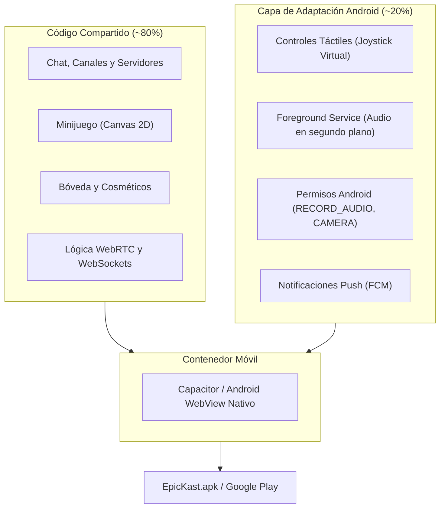
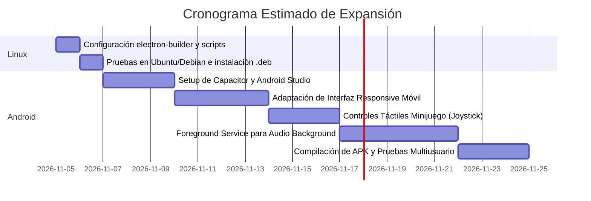

# Análisis de Viabilidad: EpicKast en Linux y Android

Este documento evalúa en profundidad la complejidad técnica, la arquitectura recomendada, los retos de plataforma y los tiempos estimados para desarrollar y desplegar versiones de **EpicKast** en **Linux** y **Android** con paridad funcional total e interoperabilidad de llamadas de voz/video con usuarios de **Windows**.

---

## 1. Resumen Ejecutivo de Complejidad

```mermaid
quadrantChart
    title Complejidad vs Impacto de Plataforma
    x-axis Baja Dificultad --> Alta Dificultad
    y-axis Bajo Impacto --> Alto Impacto
    quadrant-1 Desafío estratégico
    quadrant-2 Victoria rápida (Quick Win)
    quadrant-3 Mantenimiento menor
    quadrant-4 Desaconsejado
    "Linux (Electron Nativo)": [0.15, 0.70]
    "Android (Capacitor / Hybrid)": [0.55, 0.95]
    "Android (100% Nativo Kotlin/Compose)": [0.90, 0.85]
```

| Plataforma | Nivel de Dificultad | Reutilización de Código | Tiempo Estimado | Enfoque Tecnológico Recomendado |
| :--- | :---: | :---: | :---: | :--- |
| **Linux** (Ubuntu, Debian, Fedora, Arch) | **Muy Baja (1.5 / 10)** | **~95%** | **1 a 2 días** | `electron-builder` (`AppImage`, `.deb`, `snap`) reutilizando el código existente. |
| **Android** (Smartphones y Tablets) | **Media (5.5 / 10)** | **~75% - 80%** | **2 a 3 semanas** | **Capacitor (Ionic)** o **Tauri Mobile**, envolviendo el frontend web con servicios en segundo plano nativos. |

---

## 2. Interoperabilidad de Llamadas entre Windows, Linux y Android

> [!NOTE]
> **Compatibilidad de Llamadas:**
> La interoperabilidad entre usuarios de Windows, Linux y Android es del **100% nativa**. 
> EpicKast utiliza **WebRTC**, un estándar abierto de la W3C/IETF implementado de manera idéntica por Google en Chromium, Android y Linux.

```mermaid
sequenceDiagram
    autonumber
    actor Win as Cliente Windows
    participant Srv as Servidor EpicKast (Node.js/WS)
    actor Lin as Cliente Linux
    actor And as Cliente Android

    Note over Win,And: Protocolo de Señalización (WebSockets)
    Win->>Srv: voice.join (Room ID)
    Lin->>Srv: voice.join (Room ID)
    And->>Srv: voice.join (Room ID)
    Srv-->>Win: SDP Offer / ICE Candidates de Lin & And
    Srv-->>Lin: SDP Offer / ICE Candidates de Win & And
    Srv-->>And: SDP Offer / ICE Candidates de Win & Lin

    Note over Win,And: Enlace P2P WebRTC Directo (Opus 48 kHz / H.264)
    Win<<-->>Lin: Audio P2P Bidireccional
    Win<<-->>And: Audio P2P Bidireccional
    Lin<<-->>And: Audio P2P Bidireccional
```

1. **Mismo Códec de Audio:** Todas las plataformas usan el códec **Opus a 48 kHz**, lo que garantiza que la calidad cristalina y la latencia ultra-baja se mantengan exactamente iguales sin importar el dispositivo.
2. **Protocolo de Señalización Unificado:** El servidor `server/server.js` gestiona los mensajes de señalización (ofertas SDP y candidatos ICE) mediante WebSockets. El servidor no sabe ni le importa el sistema operativo del cliente; solo transmite los paquetes de negociación.

---

## 3. Análisis Detallado: Versión para Linux

### 3.1. ¿Por qué es tan sencillo?
EpicKast está construido sobre **Electron 38**, el cual fue diseñado desde sus raíces para ser multiplataforma. Más del 95% del código cliente (`renderer.js`, `game.js`, `style.css`, `index.html`) corre de forma idéntica en Linux.

### 3.2. Cambios Requeridos
1. **Configuración de Compilación en `package.json`:**
   Solo se necesita agregar el bloque de configuración para Linux en `electron-builder`:
   ```json
   "linux": {
     "target": ["AppImage", "deb"],
     "icon": "build/icon.png",
     "category": "Network;Chat"
   }
   ```
2. **Captura de Pantalla y Audio (X11 vs Wayland):**
   * En sistemas basados en **X11**, `desktopCapturer` funciona de forma automática.
   * En distribuciones modernas con **Wayland** (Ubuntu 22.04+, Fedora), Electron 38 ya soporta el portal de PipeWire de forma nativa para compartir pantalla.
3. **Pulsar para Hablar (Push-To-Talk) Global:**
   En Linux Wayland, por motivos de seguridad del sistema operativo, las aplicaciones no pueden escuchar pulsaciones globales de teclado si la ventana está en segundo plano a menos que se use el portal de atajos de escritorio (`xdg-desktop-portal`). La detección de voz (VAD) funciona sin ninguna restricción.

---

## 4. Análisis Detallado: Versión para Android

Electron **no se ejecuta en Android**. Sin embargo, debido a que el cliente de EpicKast está desarrollado en **JavaScript Vanilla, HTML5 Canvas y CSS3**, no tenemos que reescribir la lógica desde cero en Java/Kotlin.



### 4.1. Arquitectura Recomendada: Capacitor (Ionic)
**Capacitor** es la herramienta estándar moderna de la industria para empaquetar aplicaciones web modernas dentro de un contenedor nativo de Android:
* Empaqueta el HTML/JS/CSS dentro de un `Android WebView` de alto rendimiento (basado en el motor Chromium de Google).
* Soporta **WebRTC nativo** con aceleración de hardware para audio y video.
* El minijuego en Canvas 2D se ejecuta a 60 FPS fluidos en la GPU de cualquier teléfono Android moderno.

### 4.2. Desafíos Específicos de Android y Cómo Resolverlos

#### 1. Audio en Segundo Plano (Gestión de Energía de Android)
* **El Problema:** Cuando el usuario bloquea el teléfono o cambia a un juego (ej. Free Fire, Roblox, COD Mobile), Android suspende o mata las aplicaciones en segundo plano para ahorrar batería, lo que cortaría la llamada.
* **La Solución:** Implementar un **Android Foreground Service** (Servicio en primer plano) con una notificación persistente (*"EpicKast: Conectado a Sala General"*). Esto le indica al kernel de Android que la app es un servicio de audio prioritario y no debe ser suspendida.

#### 2. Controles del Minijuego (Táctil vs WASD/Ratón)
* **El Problema:** El minijuego actual usa teclado (`WASD`) y clics de ratón (izquierdo para espada, derecho para ballesta).
* **La Solución:** Inyectar una capa táctil cuando la app detecta un dispositivo móvil:
  * **Joystick virtual flotante** en la esquina inferior izquierda de la pantalla para el movimiento.
  * **Dos botones táctiles flotantes** en la esquina inferior derecha: un botón grande para la espada melee `[ ⚔️ ]` y un botón secundario para la ballesta `[ 🏹 ]`.

#### 3. Permisos en Tiempo de Ejecución (Android 13/14+)
* Se deben solicitar los permisos de `RECORD_AUDIO`, `CAMERA` y `POST_NOTIFICATIONS` en el momento en que el usuario intenta unirse a una llamada.

---

## 5. Estimación de Esfuerzo y Fases de Desarrollo



### Plan de Trabajo Sugerido:
1. **Fase 1 (Inmediata - Linux):** Compilar la versión de Linux `.AppImage` y `.deb`. Prácticamente no cuesta esfuerzo y expande inmediatamente el soporte a usuarios de PC con Steam Deck / Linux.
2. **Fase 2 (Siguiente paso - Android):**
   * Instalar `@capacitor/core` y `@capacitor/android`.
   * Adaptar la barra de navegación para formato vertical de teléfono.
   * Añadir el joystick virtual para el minijuego.
   * Configurar el servicio nativo de audio en segundo plano para que las llamadas sigan activas mientras juegas en el móvil.
